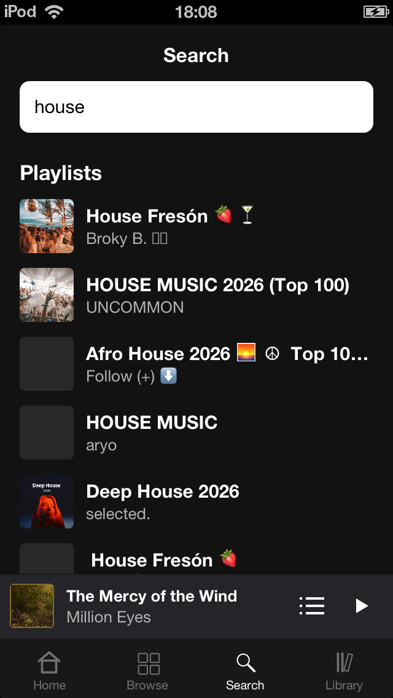
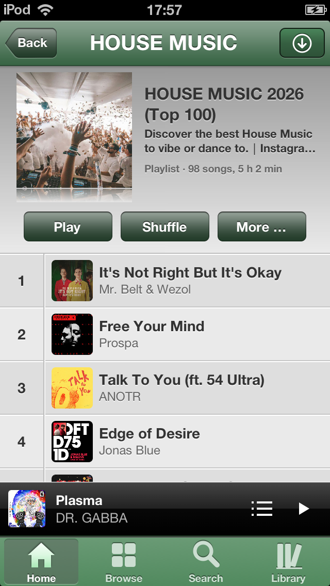
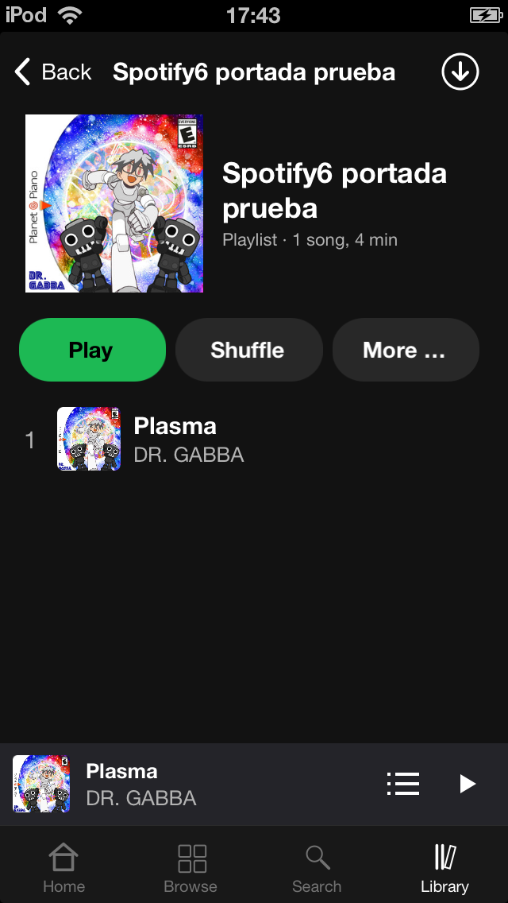
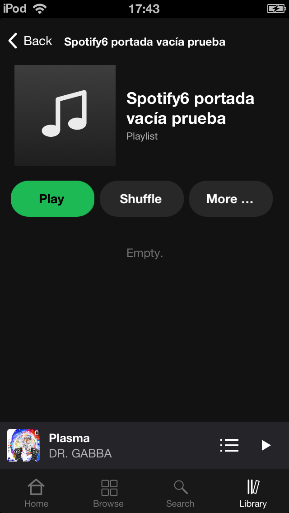

# Playlist search and management verification

## Automated checks

Run on macOS with Python 3 and the Xcode command-line tools:

```sh
python3 tests/test-pagination.py
python3 tests/test-playlist-management.py
```

Both harnesses compile the production Objective-C methods against Foundation
and replace only the transport layer. They do not contact Spotify.

| Suite | Cases | Coverage |
| --- | ---: | --- |
| Pagination | 7 | Rootlist and nested playlist pages, absolute next URLs, empty lists, malformed responses, later-page 401/429/503 failures without partial success |
| Playlist management | 6 | Unicode names, creation and rootlist insertion, failed/malformed creation, rootlist failure without duplicate creation, foreign-owner rejection, revision-guarded rename |

## Device results

Verified on a physical **iPod touch 5 (iPod5,1), iOS 6.1.3**, using a Premium
account and a configured search key, on **2026-11-03**. The final release installed
on the device is version 1.2.3, build 1.2.3.4.

- Searching `house` returned public playlists with names, owners and artwork.
  Opened an unsaved result and reopened it from Recent searches.
- Started a 98-song playlist from its first 50 loaded rows. The queue contained
  all 98 songs, audio played and elapsed time advanced. Shuffle changed the
  ordering; Play restored the complete original ordering and disabled shuffle.
- Saved and removed the public playlist; both writes returned HTTP 200 and the
  library/menu reflected the resulting account state.
- Created an empty playlist from Library and verified it remained visible after
  restarting the app. Renamed it and read back the new name from metadata and
  the song picker. Other users' playlists did not offer Rename.
- Added songs through the picker and verified the open playlist refreshed
  automatically, without reopening it.
- Created a playlist from the song picker with `á`, `&` and `+` in its name;
  verified the name and the added song. Blank and whitespace names created
  nothing; Cancel dismissed the prompt without writing.
- Downloaded the temporary playlist and checked the downloaded-song list.
  With app HTTPS blocked and reachability overridden by the debug offline
  helper, playback from the downloaded file advanced past eight seconds.
  This was app-level network-loss testing, not a change to device Wi-Fi.
  Removed the download and verified the downloaded-song list was empty.
- Offline search displayed its explanation. Submitting `house` followed by
  `jazz` left the newer Jazz results rather than the earlier response.
- Inspected cover and compact layouts in both skins. Classic controls use
  UIKit's native bordered-button artwork with the same tint as Back; their
  visible face is 30 points high inside a 44-point touch target.
- Verified the music-note placeholder for an empty playlist on its page,
  in Library and in the picker. After opening the empty playlist and then
  adding a song, the real album artwork appeared immediately. Artwork also
  survived restart and skin changes. The empty-list message sits below controls.
- Removed all temporary playlists and test downloads, restored the original
  skin and player state, and reinstalled the release build. Checked that debug
  command/search/offline hooks are absent from the release executable.

**Limits:** iOS 5 runtime behavior and iPad rotation have not been tested on
hardware. The release compiles with the existing iOS 5 availability checks and
`-Werror`; the host tests do not validate UIKit, audio decoding or live Spotify
service compatibility.

## Build validation

Built and installed both debug and release IPAs with Theos and an iPhoneOS 9.3
SDK. On this host, the SDK's legacy TAPI stubs needed an existing converted
copy; the build used `SYSROOT` and `ISYSROOT` overrides. No SDK files are included
in the repository. Example with a prepared SDK:

```sh
THEOS="$HOME/theos" gmake -j4 package FINALPACKAGE=1 \
  SYSROOT=/path/to/iPhoneOS9.3.sdk-device \
  ISYSROOT=/path/to/iPhoneOS9.3.sdk-device
```

The app and mbedTLS use ARM mode (`-marm`) for the modern linker/iOS 6 startup
combination verified here. The stb_vorbis change replaces a pointer-overflow
bounds expression with a length comparison, retaining strict compiler warnings.

## Service behavior

Search adds `playlist` to the existing developer-key Web API request. Playlist
reads, membership, save/remove and rename use the existing internal playlist
service. Creation posts a playlist4 Delta to `/playlist/v2/playlist`, then adds
its returned URI to the rootlist with `attributes.public: false` (not published
on the profile). The public Web API creation request returned 429 for this login
client; the internal creation flow succeeded on the device.

Creation and rootlist insertion are separate writes. If insertion fails, the
created ID is retained and the UI reports the library-save failure. It does not
repeat creation. Renaming rechecks ownership and submits the fetched revision.

References:

- [Spotify Search API](https://developer.spotify.com/documentation/web-api/reference/search)
- [playlist4 protocol definitions](https://github.com/librespot-org/librespot/blob/dev/protocol/proto/playlist4_external.proto)

## Reviewer checks

For additional device coverage:

- Search using reserved query characters, clear an in-flight search, and change
  the search key while a request is pending.
- Use a library with more than 100 entries and a playlist longer than 100 songs;
  verify membership, song-picker pagination and full queues.
- Fail a later playlist page and check that playback is not replaced by a
  partial queue. Fail membership loading and verify the app does not guess
  whether to save or remove.
- Check create/add/rename failures, interrupted downloads, iOS 5 startup and iPad
  rotation in both cover and compact layouts.

## Screenshots

These are device screenshots. Temporary playlists used for artwork checks were
removed afterward. The Spotify-style controls are unchanged by the final
Classic-only gradient refinement.

| Playlist search | Classic playlist controls |
| --- | --- |
|  |  |

| Spotify playlist controls | Empty playlist artwork |
| --- | --- |
|  |  |
